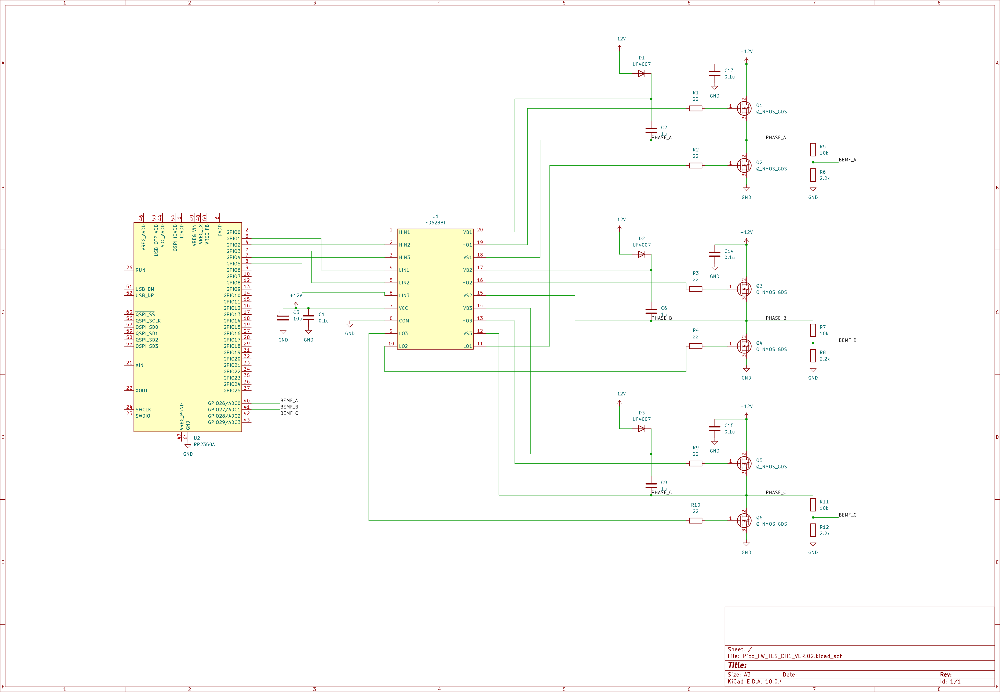

# PiESC-FW (test rig firmware)

Open-source ESC firmware for the RP2350 (Raspberry Pi Pico 2), part of the [PiESC](https://github.com/CoPYGolF97/PiESC) project. License: GPL-3.0.

> **Status: experimental test-bench firmware. NOT flight-ready. Do not fly it.**
> It is open loop (no rotor position feedback), has no overcurrent protection, and can lose sync under load. See [STATUS.md](STATUS.md).

## What works (tested on a perfboard rig)

- Open-loop **sinusoidal** drive (default) and open-loop 6-step drive, complementary PWM 20 kHz with dead time, motor commutated from timer interrupts.
- Throttle input on GP6: **DShot150/300/600** (PIO receiver) or 1-2 ms **PWM**; arming (0.5 s of zero throttle), failsafe (100 ms), DShot commands 7/8 for direction. Tested with a Betaflight flight controller (DShot300, motor test sliders).
- Smooth start, soft stop, throttle-follow speed/voltage (V/f) control, no stumble on fast throttle changes.
- Direction, drive type and input mode are saved in flash (last 4 KB sector) and survive power off.

Not done: back-EMF sensing / closed loop, current sensing and protection, input protocol auto-detect, configurator, telemetry, multi-motor.

## Test rig hardware

- Raspberry Pi Pico 2, FD6288T 3-phase gate driver, 6x IRLZ44N, 12 V supply, EMAX RS2205 2300KV motor.
- Pins: A HIN=GP0 LIN=GP1, B HIN=GP2 LIN=GP3, C HIN=GP4 LIN=GP5, throttle input GP6, phase voltage dividers (10k/2.2k) on GP26/27/28 (not used by the current firmware).
- 

## Build and upload

PlatformIO with the Pico SDK (see `platformio.ini`). Hold BOOTSEL while plugging in USB to upload. Serial monitor at 115200 baud (USB).
Only one `main.cpp` may exist in `src/`.

## Serial keys

| Key | Action |
|---|---|
| `?` | status |
| `x` | emergency stop and disarm |
| `m` | input mode KEYS / DSHOT / PWM (saved) |
| `d` | drive type 6-STEP / SINE (only while stopped, saved) |
| `r` | reverse direction (only while stopped, saved) |
| `s`, `+`, `-`, `f`, `g` | KEYS mode only: start, duty, step time |
| `a`, `o` | measurement helpers (phase voltages, scope capture) |

In DSHOT/PWM mode the motor arms after 0.5 s of zero throttle, then the throttle sets speed and amplitude together.

## Safety

- Use a **current-limited supply** and a fuse. There is no current protection in the firmware.
- Never hold the motor by hand while it runs (stall current is not limited).
- Secure the motor and wear eye protection when testing with a propeller. Never test on a drone.

## Credits

- Concepts of 6-step commutation and ESC firmware structure were studied from open-source ESC projects such as [AM32](https://github.com/am32-firmware/AM32) (inspiration only, no AM32 code is used).
- Built with the Raspberry Pi Pico SDK. Developed by COPYGOLF with the help of Claude (AI assistant by Anthropic).

## Contributing

Help is welcome, especially on closed-loop (BEMF) commutation, protection and the configurator. Open an issue or a pull request.
