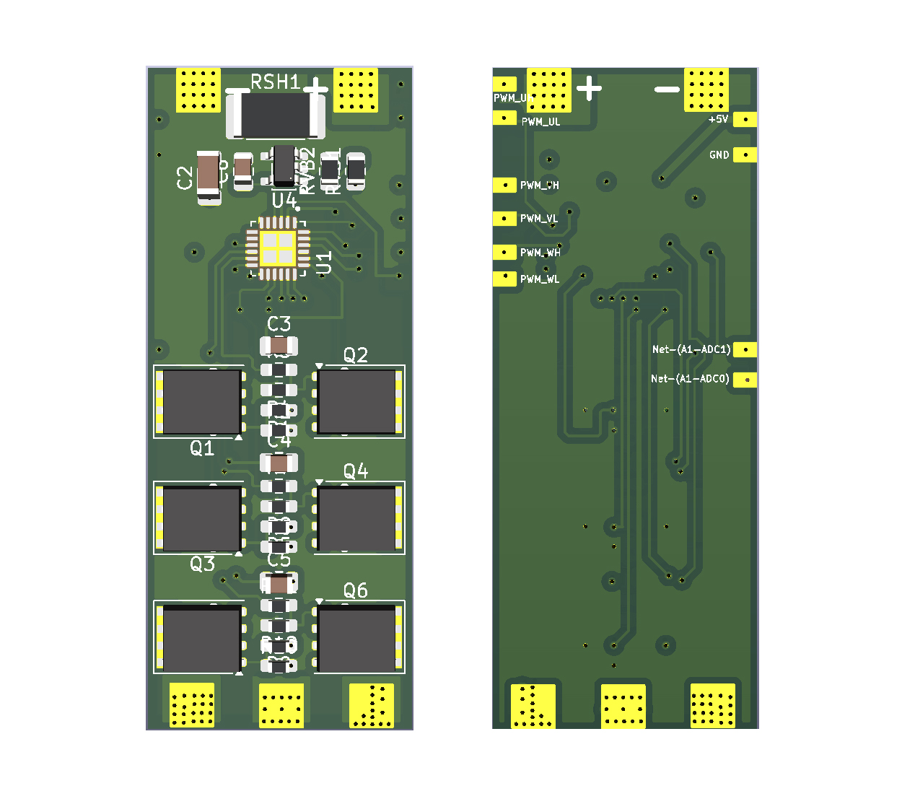
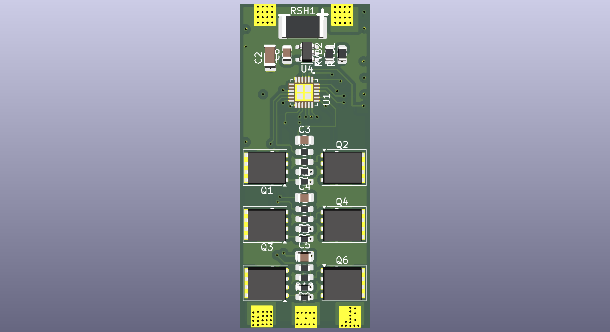
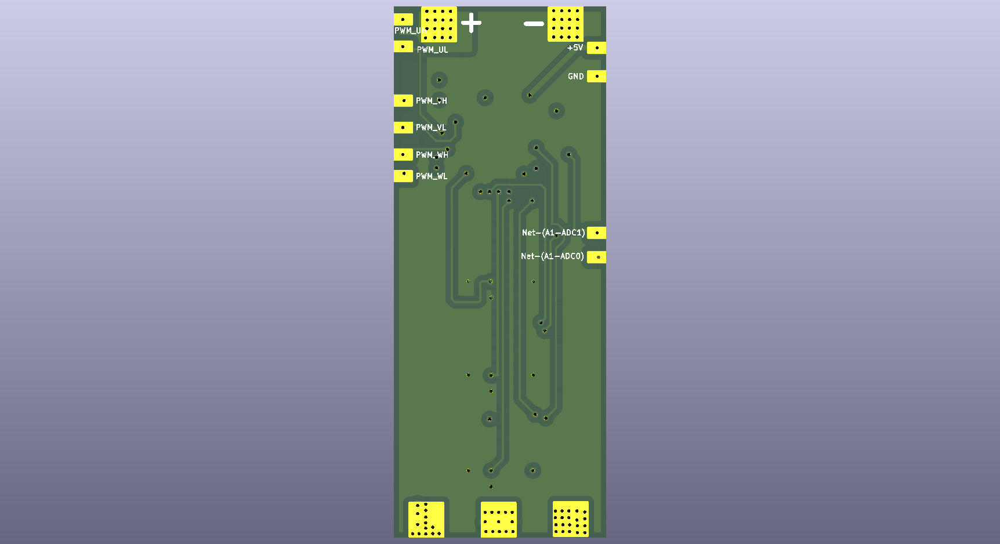
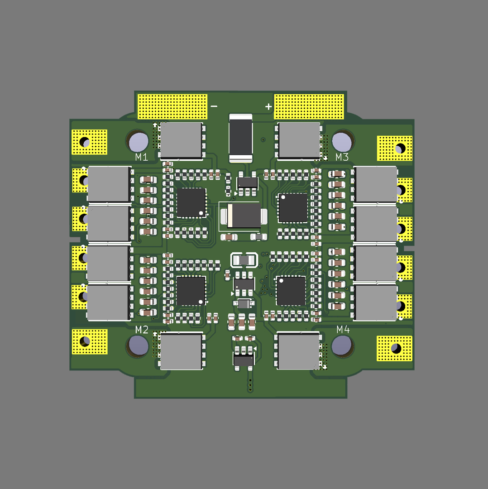
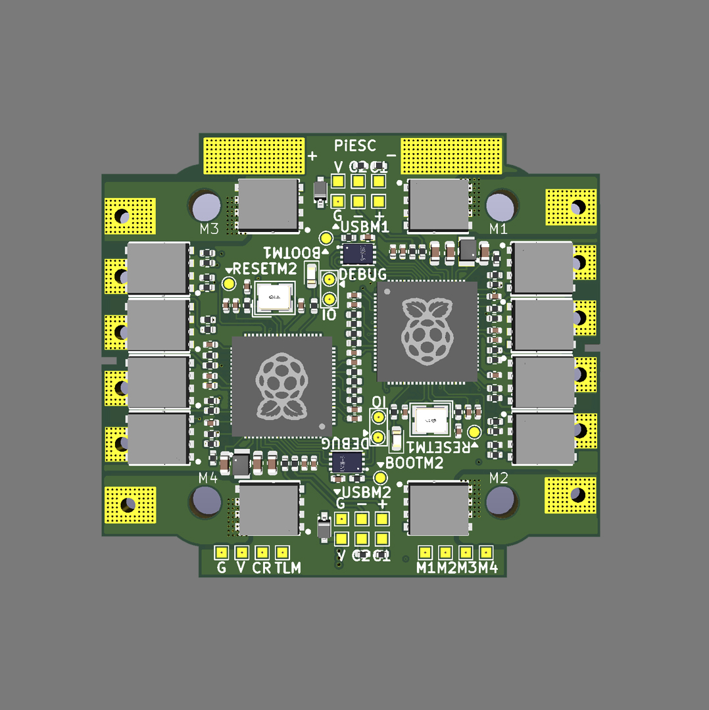

# PiESC

**An independent open-source ESC project for RP2350.**

### PiESC S1 PCB 20×50

| Front                                                              | Back                                                              |
| ------------------------------------------------------------------ | ----------------------------------------------------------------- |
|  |  |

---
### PiESC 4in1 45X50

| Front                                                              | Back                                                              |
| ------------------------------------------------------------------ | ----------------------------------------------------------------- |
|  |  |

---
## English

**PiESC** is an open-source Electronic Speed Controller (ESC): the board that drives the brushless motors of a drone or other multirotor aircraft. It is built around the **RP2350** microcontroller (the chip family of the Raspberry Pi Pico 2). The name comes from "Pi" (RP2350 / Pi Pico family) + "ESC".

PiESC is an open-source project exploring the design and development of ESC firmware and hardware using the RP2350 microcontroller.

The goal is to create another open-source option for ESC development, learning, experimentation, and future community collaboration.

### Project Status

🚧 **Early Development**

PiESC is currently an experimental project.

The hardware and firmware are being developed and tested step by step. Features, circuit designs, firmware architecture, and documentation may change during development.

Nothing here has been run on a motor or flown yet.

⚠️ This design handles high current from lithium batteries. Mistakes can cause fire or damage. Build and test at your own risk: start with a current-limited power supply, and never leave it unattended.

| Item | State |
| --- | --- |
| PiESC S1 PCB 20×50 (first single-ESC board) | Designed, files in this repository |
| PiESC 1CH Test (1-motor, 2-layer test board) | Design finished, DRC clean. **Not yet ordered or tested** |
| PiESC 4-in-1 V4, 45×50 mm (2× RP2350B, 6-layer HDI) | Layout finished, DRC clean. **Not yet ordered or tested** |
| Firmware on a Raspberry Pi Pico 2 dev board | LED blink, USB serial, 3 complementary PWM pairs at 20 kHz with dead-time, open-loop 6-step commutation (checked with a multimeter, **not** with a motor) |
| Not done yet | DShot input, back-EMF / sensorless control, current sensing, protection (over-current, under-voltage, watchdog), telemetry |

Design files for the 1CH test board and the 4-in-1 board will be added to this repository.

### Hardware

The initial development platform uses the **RP2350** microcontroller.

Development hardware is purchased independently by the project creator.

PiESC is an independent project and is **not affiliated with, sponsored by, or endorsed by Raspberry Pi Ltd.**

### Firmware

The firmware is being developed with a focus on:

* 3-phase BLDC motor control
* PWM generation
* Motor commutation
* MOSFET gate-driver control
* Current sensing
* Motor protection
* Future sensorless control
* Future ESC telemetry and configuration

### Open Source

PiESC is intended to be an open-source project.

We welcome developers, electronics enthusiasts, researchers, makers, and anyone interested in motor control to explore the project and contribute ideas, testing, documentation, hardware designs, or code.

### How you can help
PiESC is incomplete, so help is very welcome. Good places to start:
- Review the schematics and PCB layouts (1CH Test board, 4-in-1 V4) and report mistakes
- Write a DShot decoder using the RP2350 PIO
- Back-EMF zero-crossing / sensorless control
- Protection: over-current, under-voltage, watchdog
- Telemetry over UART
- Documentation, pinouts, bring-up guides

See [CONTRIBUTING.md](CONTRIBUTING.md) and the Issues tab.

### License

This project is licensed under the **GNU General Public License v3.0**. See the [`LICENSE`](LICENSE) file.

### Development

The project is being developed using:

* RP2350 / Raspberry Pi Pico 2
* PlatformIO
* Pico SDK
* C/C++
* KiCad

### A Personal Project

PiESC was started by an ordinary electronics enthusiast who wanted to learn, experiment, and build something that others could continue developing.

The project creator is not a professional software engineer or electrical engineer. Much of the development process is based on learning through experimentation, documentation, community knowledge, and AI-assisted development.

**AI assistants are used in this project: ChatGPT in the early stage, and Claude (Anthropic) for design review, guidance, programming, debugging, and documentation. The PCBs are drawn by the project creator, and hardware is built and tested step by step as it becomes available. The creator reviews what the AI suggests, but it may still contain mistakes.**

The goal is not to claim that everything is perfect.

The goal is to build something useful, learn along the way, and make the work available for others to improve.

---

## ภาษาไทย

**PiESC** คือ Electronic Speed Controller (ESC) แบบโอเพนซอร์ส เป็นบอร์ดที่ควบคุมมอเตอร์ไร้แปรงถ่านของโดรนหรืออากาศยานมัลติโรเตอร์ สร้างบนไมโครคอนโทรลเลอร์ **RP2350** (ชิปตระกูลเดียวกับ Raspberry Pi Pico 2) ชื่อมาจาก "Pi" (ตระกูล RP2350 / Pi Pico) รวมกับ "ESC"

PiESC คือโปรเจกต์ Open Source ที่กำลังศึกษาและพัฒนา Firmware และ Hardware สำหรับ ESC โดยใช้ไมโครคอนโทรลเลอร์ RP2350

เป้าหมายของเราคือการสร้างทางเลือกอีกทางหนึ่งสำหรับการพัฒนา ESC แบบ Open Source เพื่อการเรียนรู้ การทดลอง และเปิดโอกาสให้ชุมชนเข้ามาช่วยพัฒนาต่อในอนาคต

### สถานะโปรเจกต์

🚧 **อยู่ในช่วงเริ่มต้นของการพัฒนา**

ขณะนี้ PiESC ยังเป็นโปรเจกต์สำหรับการทดลองและพัฒนา

Hardware และ Firmware กำลังถูกพัฒนาและทดสอบทีละขั้นตอน ดังนั้นคุณสมบัติ วงจร โครงสร้าง Firmware และเอกสารต่าง ๆ อาจมีการเปลี่ยนแปลงระหว่างการพัฒนา

ยังไม่เคยต่อมอเตอร์หรือบินจริง

⚠️ การออกแบบนี้ใช้กระแสสูงจากแบตเตอรี่ลิเธียม ความผิดพลาดอาจทำให้เกิดไฟไหม้หรือความเสียหาย สร้างและทดสอบด้วยความเสี่ยงของตัวเอง เริ่มต้นด้วยแหล่งจ่ายไฟจำกัดกระแส และไม่ปล่อยทิ้งไว้โดยไม่มีคนดู

| รายการ | สถานะ |
| --- | --- |
| PiESC S1 PCB 20×50 (บอร์ด ESC ตัวแรก) | ออกแบบแล้ว ไฟล์อยู่ใน repository นี้ |
| PiESC 1CH Test (บอร์ดทดสอบ 1 มอเตอร์ 2 ชั้น) | ออกแบบเสร็จ DRC ผ่าน **ยังไม่ได้สั่งผลิตและยังไม่ได้ทดสอบ** |
| PiESC 4-in-1 V4 ขนาด 45×50 mm (RP2350B 2 ตัว, HDI 6 ชั้น) | วางลายเสร็จ DRC ผ่าน **ยังไม่ได้สั่งผลิตและยังไม่ได้ทดสอบ** |
| Firmware บนบอร์ด Raspberry Pi Pico 2 | LED กะพริบ, USB serial, PWM 3 คู่ 20 kHz พร้อม dead-time, คอมมิวเทต 6 สเต็ปแบบ open-loop (ตรวจด้วยมัลติมิเตอร์ **ยังไม่ได้ต่อมอเตอร์**) |
| ยังไม่ได้ทำ | รับสัญญาณ DShot, BEMF / sensorless, การวัดกระแส, ระบบป้องกัน (กระแสเกิน แรงดันต่ำ watchdog), Telemetry |

ไฟล์ออกแบบของบอร์ด 1CH Test และ 4-in-1 จะทยอยเพิ่มใน repository นี้

### Hardware

แพลตฟอร์มเริ่มต้นของโปรเจกต์ใช้ไมโครคอนโทรลเลอร์ **RP2350**

Hardware ที่ใช้ในการพัฒนาถูกจัดซื้อโดยผู้ริเริ่มโปรเจกต์เอง

PiESC เป็นโปรเจกต์อิสระ และ **ไม่มีความเกี่ยวข้อง ได้รับการสนับสนุน หรือได้รับการรับรองจาก Raspberry Pi Ltd.**

### Firmware

Firmware กำลังได้รับการพัฒนาโดยมุ่งเน้นไปที่:

* การควบคุมมอเตอร์ BLDC แบบ 3 เฟส
* การสร้าง PWM
* การ Commutation ของมอเตอร์
* การควบคุม MOSFET Gate Driver
* การวัดกระแส
* ระบบป้องกันมอเตอร์และ ESC
* การควบคุมแบบ Sensorless ในอนาคต
* Telemetry และการตั้งค่า ESC ในอนาคต

### Open Source

PiESC ตั้งใจให้เป็นโปรเจกต์ Open Source

เรายินดีต้อนรับนักพัฒนา ผู้สนใจอิเล็กทรอนิกส์ นักวิจัย Maker และทุกคนที่สนใจด้านการควบคุมมอเตอร์ ให้เข้ามาศึกษา ทดลอง เสนอแนวคิด ทดสอบ ปรับปรุงเอกสาร Hardware หรือ Firmware และช่วยพัฒนาโปรเจกต์ต่อ

### ช่วยเราได้อย่างไร
PiESC ยังไม่สมบูรณ์ ยินดีรับความช่วยเหลือมาก ตัวอย่างงานที่เริ่มได้:
- ตรวจ Schematic และ PCB (บอร์ดทดสอบ 1CH, 4-in-1 V4) และแจ้งข้อผิดพลาด
- เขียนตัวถอดรหัส DShot ด้วย PIO ของ RP2350
- BEMF zero-crossing / การควบคุมแบบ sensorless
- ระบบป้องกัน: กระแสเกิน แรงดันต่ำ watchdog
- Telemetry ผ่าน UART
- เอกสาร พินเอาต์ และคู่มือทดสอบบอร์ดครั้งแรก

ดู [CONTRIBUTING.md](CONTRIBUTING.md) และแท็บ Issues
### ใบอนุญาต (License)

โปรเจกต์นี้ใช้ใบอนุญาต **GNU General Public License v3.0** ดูรายละเอียดในไฟล์ [`LICENSE`](LICENSE)

### เครื่องมือที่ใช้ในการพัฒนา

โปรเจกต์นี้ใช้:

* RP2350 / Raspberry Pi Pico 2
* PlatformIO
* Pico SDK
* C/C++
* KiCad

### จุดเริ่มต้นของโปรเจกต์

PiESC เริ่มต้นจากคนธรรมดาที่สนใจอิเล็กทรอนิกส์ และต้องการเรียนรู้ ทดลอง และสร้างสิ่งที่คนอื่นสามารถเข้ามาช่วยพัฒนาต่อได้

ผู้ริเริ่มโปรเจกต์ไม่ได้เป็นวิศวกรซอฟต์แวร์หรือวิศวกรไฟฟ้ามืออาชีพ การพัฒนาส่วนหนึ่งเกิดจากการเรียนรู้ผ่านการทดลอง การศึกษาข้อมูล ความรู้จากชุมชน และการใช้ AI ช่วยในการพัฒนา

**โปรเจกต์นี้ใช้ AI เป็นผู้ช่วย: ช่วงแรกใช้ ChatGPT และต่อมาใช้ Claude (Anthropic) ช่วยตรวจแบบ ให้คำแนะนำ เขียนโปรแกรม แก้ไขข้อผิดพลาด และจัดทำเอกสาร ผู้ริเริ่มโปรเจกต์เป็นผู้วาด PCB และสร้าง/ทดสอบฮาร์ดแวร์ทีละขั้นเมื่อมีของพร้อม ตรวจทานสิ่งที่ AI เสนอ แต่ยังอาจมีข้อผิดพลาดได้**

เราไม่ได้อ้างว่าโปรเจกต์นี้สมบูรณ์แบบ

เป้าหมายคือการสร้างสิ่งที่มีประโยชน์ เรียนรู้ไปพร้อมกับการพัฒนา และเปิดผลงานให้ผู้อื่นสามารถเข้ามาช่วยปรับปรุงต่อได้

---

**PiESC — Build it. Test it. Improve it.**

**PiESC — สร้าง ทดลอง และพัฒนาไปด้วยกัน**
